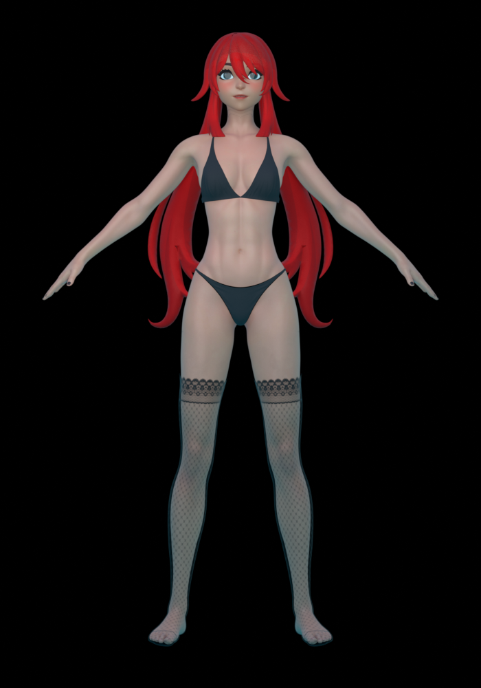
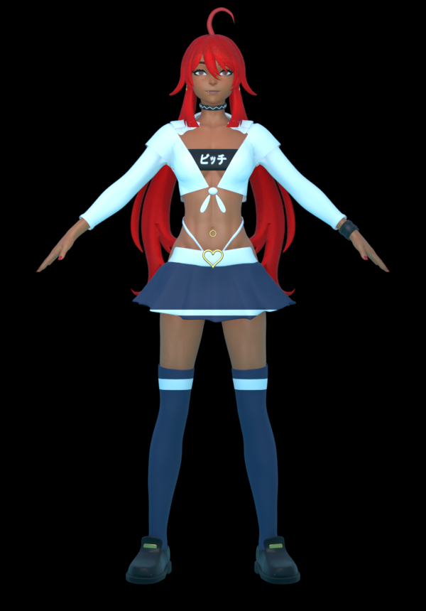

# Character restyle

Scripts that restyle the rigged character `.blend` (Blender 4.1) to the rebel
reference look. The `.blend` itself is ~100 MB and is not stored in the repo.

    blender -b original.blend -P restyle.py -- restyled.blend
    blender -b restyled.blend -P preview.py -- previews/ full bust side face

`restyle.py` needs `label_bitch.png` next to it (regenerate with
`python make_label.py`, requires Pillow and a Japanese font).

| Before | After |
| --- | --- |
|  |  |

What changes: warm tan skin, small dark-red irises, upturned half-lidded eyes,
thinner lips with a neutral expression, vivid red hair, toned-down blush,
long red nails, ahoge strand, open long-sleeved white shirt knotted over a
black lettered bandeau, navy pleated skirt with white hem stripe, white belt
and gold heart buckle, navy thigh-highs with a white band, choker, gold hoop
earrings, navel ring, gold lip and tongue barbells and a black leather cuff on the left wrist.
All new pieces are skinned or bone-parented to the existing rig.
